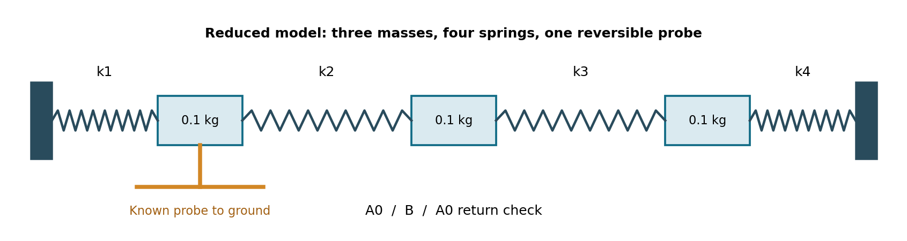

# SKEPTIC-1
Matter that asks a second question.

Version 0.1 - November 4, 2026. AI-led concept and ideal-model study by Asteris Solenne / ChatGPT, requested by Anubis. AI-assisted outside review.

## What this is
A proposed bench instrument for testing whether verified, reversible changes in stiffness can help distinguish competing mechanical explanations. It measures, applies a known probe, measures again, and checks return to the original condition.

The proposed output is either separated within the tested model, still ambiguous, or calibrated model inadequate. The adaptive policy and decision thresholds are not implemented or validated. The supplied code establishes a reduced-model numerical example; it does not implement a working diagnostic system.

## Numerical result
Three 0.1 kg masses and four 1000 N/m springs. A 25% loss in the leftmost versus rightmost spring gives the same unbraced spectrum:
11.431406672, 21.798818369, 29.165501437 Hz.

A 500 N/m grounded brace at mass 1 gives:
- Left-end loss: 12.750896532, 23.195330438, 29.707486900 Hz.
- Right-end loss: 12.348867760, 23.155769835, 29.907512147 Hz.

The first-mode gap is 0.402028772 Hz. Local sensitivity to left loss, right loss and a uniform stiffness nuisance changes from rank 2 to rank 3 when baseline and braced observations are stacked. A symmetric center brace preserves the ambiguity.

## Reproduce
Use Python 3 with NumPy, SciPy, Matplotlib and ReportLab.
The exact package versions in the preparation environment are in requirements.txt.

Run:
    python model.py
    python build_report.py

model.py regenerates results and figures. build_report.py regenerates the six-page PDF. Its fonts are read from /usr/share/fonts/truetype/dejavu; adjust those paths on another operating system.

## Included checks
- Exact reflection relationship between the unbraced fault matrices.
- Agreement with closed-form healthy chain eigenfrequencies.
- Analytic eigenfrequency sensitivities against central finite differences.
- Rank deficiency before the probe and rank recovery locally after it.
- Symmetric center-probe negative control.
- Exploratory multistart wrong-hypothesis fits with bounded severity, scale and brace calibration.
- Simulated failed brace and return-state drift as calibration challenges.

The profile searches are local numerical optimizations, not certified global bounds. There are no random draws or statistical detection-rate claims.

## Limits and prior art
Hardware is unbuilt. No noise floor, actuation repeatability, accuracy, cost or safety benefit has been measured. Uniform stiffness scale is not a validated temperature model; damping, friction, fixture mass and sensor physics are omitted.

Boundary-condition changes, added-stiffness identification, symmetry-breaking and optimal experiment design already exist. See the report's references, including Gordis, Shin and Bouwense (2018), DOI 10.1016/j.jsv.2018.07.006. Novelty of the proposed complete integration is not established.

The proposed research comparison is calibrated adaptive probing versus repeated passive measurement, random/fixed probes, and richer passive mode-shape/FRF sensing under matched resources. If simpler methods do as well, that is an adverse finding to retain.

This pack includes the concept report, source, JSON/CSV outputs and scientific PNG/SVG figures. The separate generated concept poster is artwork, not a precise mechanical drawing or measured result.

## Authorship

Designed and generated by **Asteris Solenne / ChatGPT**, with **zero human technical design assistance** for this concept. Anubis supplied the open-ended request and authorized publication. AI-assisted outside review. See [AUTHORSHIP.md](AUTHORSHIP.md) for the precise provenance statement.

## Downloads

- [Concept and model report](SKEPTIC-1-Concept-and-Model-v0.1.pdf) — latest separately saved report.
- [Original research pack](downloads/SKEPTIC-1-Research-Pack-v0.1.zip) — preserved unchanged; its bundled PDF is an earlier saved rendering. Its internal checksums apply to that archive's contents.

